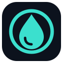

<p align="center"></p>

# AquaLite

Controle de telas LCD USB para Windows, com interface em português, sensores do PC e personalização visual.

## Recursos

- Janela com tamanho fixo e prévia circular de 480 × 480.
- Temperaturas de CPU/GPU, memória, carga, rede e volume quando disponíveis.
- Editor de texto, relógio, sensores e barras.
- Galeria com três temas próprios: Aqua, Brasa e Oceano.
- Troca automática de temas, sequencial ou aleatória.
- Imagens, GIFs e vídeos pessoais; vídeo H.264 no LCD compatível.
- Brilho, rotação e operação na bandeja do Windows.
- Serviço que mantém o LCD funcionando desde a inicialização do computador, antes do login.

O transporte USB atende atualmente ao dispositivo `VID 1CBE / PID 0021` com driver WinUSB já configurado. Outros dispositivos precisam de adaptação e testes. O aplicativo não controla bomba ou ventoinhas e não atualiza firmware.

## Compilar e abrir

No Windows x64, com .NET Framework 4.8 disponível:

```powershell
.\build.ps1
.\build\app\AquaLite.exe
```

A compilação usa o compilador do Windows e gera os ícones e as prévias dos temas a partir de código e dados incluídos neste repositório. Não precisa de Node.js, Python ou acesso à internet.

Para executar os testes locais, sem enviar dados ao LCD:

```powershell
.\build.ps1 -Test
```

Para criar o instalador, também é necessário Inno Setup 6 ou 7:

```powershell
.\build.ps1 -Test -Package
```

O resultado é `dist/AquaLite-Instalador.exe`. O instalador em português cria atalhos, registra a desinstalação e configura o serviço `AquaLiteDisplay` com inicialização automática. Consulte [instalação e serviço](docs/SERVICE.md).

## Componentes opcionais

O painel básico, o relógio, os temas e o editor funcionam sem bibliotecas adicionais. A temperatura da CPU precisa do leitor de sensores e de acesso autorizado pelo Windows. Vídeos MP4 precisam do FFmpeg. Consulte [dependências opcionais](docs/DEPENDENCIES.md).

Os componentes opcionais não são baixados nem instalados pela compilação. Binários, instaladores, mídias pessoais e fontes externas não fazem parte do repositório.

## Estrutura

```text
src/AquaLite/     aplicativo C# organizado por área
themes/          dados dos três temas próprios
assets/          identidade visual vetorial
tools/           geração de recursos e conversão de vídeos
installer/       instalador para Windows com serviço automático
tests/           testes locais sem USB
docs/            arquitetura, dependências e publicação
.github/         compilação automática e formulário de problemas
```

Na versão instalada, as preferências e mídias importadas ficam em `%PROGRAMDATA%\AquaLite`, disponíveis ao serviço antes do login. A primeira instalação importa a configuração local anterior quando disponível. A execução de desenvolvimento usa `%LOCALAPPDATA%\AquaLite`. O clima é opcional e consulta a Open-Meteo apenas quando habilitado.

## Publicar no GitHub

Publique **esta pasta**, não a pasta de trabalho que a contém. Veja [o passo a passo](docs/GITHUB.md). A automação compila e testa o projeto no Windows a cada push ou pull request.

Código e temas próprios sob [licença MIT](LICENSE). Componentes opcionais conservam suas próprias licenças: [avisos de terceiros](THIRD_PARTY_NOTICES.md).
