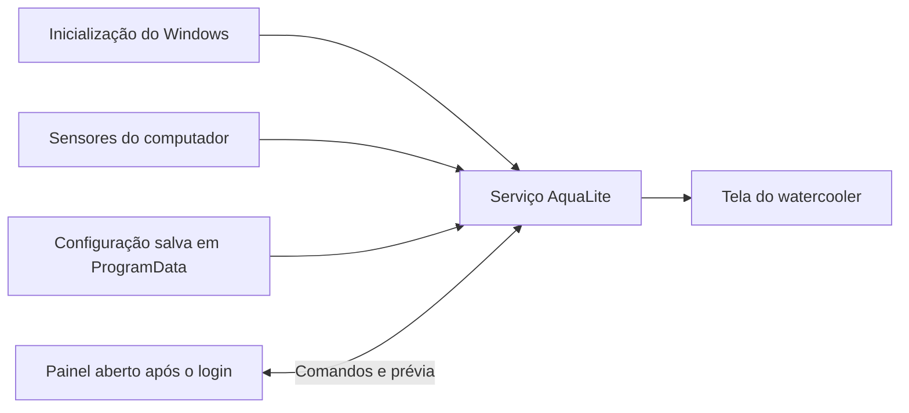

# Instalação e funcionamento antes do login

Execute `AquaLite-Instalador.exe` e autorize a instalação no Windows. O programa é instalado em Arquivos de Programas, recebe atalhos e aparece em Aplicativos instalados para desinstalação.

O instalador registra `AquaLiteDisplay` como serviço Win32 próprio, com conta LocalSystem e início Automático. O Windows inicia esse serviço quando o sistema operacional está carregando, antes de qualquer usuário entrar na conta. A tela não depende de um atalho de inicialização, tarefa de logon ou painel aberto. O aplicativo não é executado durante BIOS/UEFI: drivers USB e o Windows precisam estar disponíveis.

O serviço carrega a última configuração salva e tenta reconectar se o USB ainda não estiver pronto. Os temas, o renderizador e o fluxo H.264 são os mesmos do motor do aplicativo. A thread do serviço lê os sensores diretamente; a instalação prepara o acesso quando os componentes opcionais estão presentes.

## Painel e serviço

Abra AquaLite pelo menu Iniciar para ajustar o tema, brilho e demais preferências. O painel se comunica com o serviço e não abre outra sessão USB. Fechar o painel preserva o funcionamento da tela. O botão de pausar envio continua disponível. A opção “Ligar a tela junto com o computador” controla o início automático do serviço.

O painel pede autorização de administrador conforme configurado. A comunicação local utiliza um pipe com acesso restrito a administradores e LocalSystem; acessos de rede são negados. O cliente verifica se o processo servidor é o serviço registrado no Windows. As mensagens têm tamanho limitado, e o serviço não executa comandos de shell enviados pelo painel.

## Arquivos e atualização

- Programa: `%ProgramFiles%\AquaLite`.
- Configuração e mídias: `%ProgramData%\AquaLite`.
- Estado recente: `service-status.json` na pasta de dados.
- Registro de problemas: `servico.log` e `diagnostico.log`.
- Erros de instalação: `instalacao-erro.txt`.

A primeira instalação importa a configuração de `%LocalAppData%\AquaLite` quando existente e copia o fundo importado para a pasta compartilhada. Atualizações preservam a configuração salva. A desinstalação para e remove o serviço, os atalhos e o programa; a pasta de dados e o componente de sensores já instalado ficam preservados.

## Verificação

Um serviço com estado Running, início Automatic e processo na sessão 0 demonstra que o motor não pertence à sessão de login. `service-status.json` mostra a conexão USB, o tema, o horário da amostra e a temperatura da CPU quando disponível. Uma verificação após reinicialização ainda é necessária para confirmar o comportamento durante o boot completo deste computador.

Os testes automáticos usam um motor sem USB e uma comunicação de teste isolada. Verificam prévia, comandos, persistência, reconexão do painel e funcionamento do motor após fechar o cliente. Eles não instalam serviço, alteram o registro ou reiniciam a máquina.

Referências: [serviços do Windows](https://learn.microsoft.com/en-us/dotnet/framework/windows-services/introduction-to-windows-service-applications), [separação entre serviço e interface](https://learn.microsoft.com/en-us/windows/win32/services/interactive-services).
